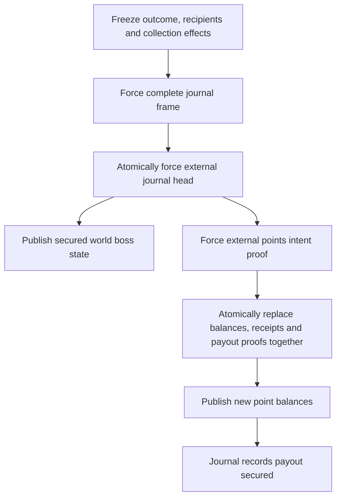

# World boss recovery contract and operator runbook

Implementation date: November 18, 2026; updated November 21 for scoped native autosave I/O and bounded startup arena restoration. This documents the local single-server recovery implementation, not production signoff. A native process-crash/missing-projection case now passes; interrupted-payout boundaries, broader fault/restore rehearsals and deployment remain outstanding.

## Authority and commit order

`<world>/data/cobbleraids_world_boss.journal` is the world boss authority. Its full snapshots include campaign/legacy advancement, Worldheart grants and frozen rolls, blessing windows and bonus outbox, scenes/preferences, admission checkpoints, travel origins, active event state and immutable payout promises. `cobbleraids_world_boss.dat` is a rebuildable NBT projection. The points file remains authoritative for balances, purchases, spending and credited amounts.

No points effect is allowed before its exact payout/recipient/amount promise is acknowledged by the journal. Victory, timeout/cancellation and ordinary-raid blessing bonuses use the same scoped settlement path. Empty and zero-value promises still receive proof. Balance-cap overflow remains claimable; its proof identifies the entire immutable promise rather than requiring all points to fit immediately. Claims do not create a new promise or repeat credited portions.

Recorded legacy paid outcomes are imported as untracked baselines. Missing historical receipts do not create a compensation claim. Older pending plans acquire proof when retried against the existing deduplication receipts. Previously unrecorded ordinary-raid outcomes cannot be reconstructed by this journal.

Both the journal frame and external head must be forced before any commit is
acknowledged. Periodic checkpoints now capture a detached snapshot on the server
thread and perform journal I/O on one bounded worker, with at most one outstanding
checkpoint. Submission is not acknowledgment: publication waits for completion,
and mutations after capture stay dirty. A pending write older than two seconds
puts combat into a storage Hold without waiting on the disk in that tick.
Payouts, explicit strict commits, manual/forced saves and clean shutdown drain
earlier checkpoints before committing; these paths still wait for durability.
Start, opening, hold and recovery controls use their own forced asynchronous
receipts: their commands report queued work, and publication waits for each
receipt. Eligible automatic native saves use the acknowledged checkpoint worker
as well; submission cannot clear changes made after capture. Shutdown
drains accepted I/O even if its caller was interrupted and then restores the
interrupt flag. Slow/unresponsive storage can therefore still delay a critical
transition or graceful shutdown. Journal failure quarantines the authority and
prevents later economic effects or replacement writes; an in-memory Hold is not
reported as a persisted acknowledgment when storage has failed. Unacknowledged
combat progress can roll back to the last recovered complete checkpoint after a
crash, as before. The journal format and recovery witnesses are unchanged.

Policy v19 also uses acknowledged checkpoints for automatic arena arrivals.
At most eight staged origins/settings share a forced checkpoint; native moves
start only after its receipt, at most two per tick. A second receipt protects
arrival acknowledgments before success publication and automatic enrollment.
Cancellation, failed movement or failed acknowledgment retain the saved origin.
Manual critical travel/returns still wait for durability. See
[acknowledged arena arrivals](WORLD-BOSS-ARRIVAL-IO-2026-11-20.md) for sequencing,
test scope and remaining performance limits.

Policy v21 also queues start and staff recovery as acknowledged control
continuations. They wait for any earlier checkpoint, then publish standing
boss creation/announcements or regroup only after their own forced receipt.
Command acceptance is explicitly distinct from a saved transition. Hold, Stop,
shutdown, quarantine and overdue storage cancel unpublished control work;
accepted I/O is still drained by the critical path. Event/phase ownership is
rechecked before publication and after native entity hooks. See
[controls and spawning](WORLD-BOSS-CONTROL-AND-SPAWNING-2026-11-20.md) for evidence
and the critical operations that remain synchronous.

Policy v22 also acknowledges the combat-opening snapshot before admission,
wards and active-time accounting resume. Player-file autosaves are a separate
queue: only vanilla automatic non-flushing/non-forced batches during active
arena events detach their disk I/O. Main still serializes each native player.
Save/load barriers, forced/manual saves and shutdown drain accepted writes in
order; interruption does not discard them. Native GZIP NBT and previous backups
are retained and checked. Capacity/unsupported capture uses ordered synchronous
file operations. A worker failure holds combat and blocks subsequent event
start/recovery until restart. Player files retain vanilla file-close semantics;
they do not gain the journal's forced witness or power-loss guarantee. Slow disk
I/O can still delay a critical barrier. See the v22 section of the same evidence
document for validation scope and current approval status.

The November 21 [initialization I/O continuation](WORLD-BOSS-INITIALIZATION-IO-2026-11-21.md)
extends eligibility for those native automatic save queues to periods without
an active boss event. Serialization stays on Main and the existing forced/load/
backup/shutdown barriers remain. This also covers native world NBT and paced
advancements in that automatic save scope. It does not turn direct or critical
saves into asynchronous operations or add power-loss guarantees to vanilla files.

Policy v23 queues staff-hold persistence as well: combat suspends and owned
duels abort immediately, then the hold's full snapshot waits for its own forced
receipt. The command reports that its save is queued. Status `control save: none`
and timing `HELD / STAFF` distinguish successful acknowledgement from a failed
or superseded request. Recovery waits for this receipt. A failed simulator does
not prevent the hold from being persisted. Critical economic and shutdown
barriers continue to drain accepted writes.

During normal running, a commit does **not** rewrite the redundant
`.dat` projection. Startup recovery and the clean World Boss stopping checkpoint
refresh that cache from the journal. A crash may leave it stale or absent; replay
still restores the latest acknowledged full snapshot. A failed cache refresh does
not undo the journal commit. A `.dat` file by itself is not a valid backup. Native
autosaves use the journal-backed commit path and cannot restore the old per-commit
cache rewrite or overwrite the journal with the stale cache.

## Files in the recovery set

Arena startup waits for bounded asynchronous restoration before recreating its
standing boss, accepting arrivals or starting the regroup timer. Existing FULL
chunks can be used immediately; otherwise saved FULL data is checked across the
bounded footprint/dependency ring before temporary load tickets are added. Missing
data is not replaced by requested terrain generation. Reads/ticket additions are
bounded per tick, and failure or a 120-second timeout holds the event. Temporary
tickets release on completion/cancellation/shutdown, with the permanent lease
acquired first. See [native crash evidence](WORLD-BOSS-NATIVE-CRASH-2026-11-21.md)
for the reproduced startup bug, repair and precise native verification scope.

The v18 private simulator is runtime-only. A simulator failure/reload places
combat in `SIMULATOR_FAILURE` Hold using the same journal; recovery is refused
while that lane is unavailable. Data-pack/native registry reload requires a
server restart before world-boss combat can resume. Ordinary battles retain
their original context. See [isolated simulation](WORLD-BOSS-SIMULATION-2026-11-20.md)
for queue, ownership and native failure/reload evidence. No new backup file or
economic authority is introduced by the private context.

| Path, relative to server unless marked | Purpose |
| --- | --- |
| `<world>/data/cobbleraids_world_boss.journal` | Ordered authoritative world boss snapshots and payout catalogue |
| `<world>/data/cobbleraids_world_boss.dat` | Rebuildable projection with installation/sequence/hash provenance |
| `<world>/data/cobbleraids_player_records.dat` | Point balances, ordinary progression, credited/pending receipts, recovery identity and payout proofs |
| `config/cobbleraids/worldboss-recovery/journal.head` | External installation/sequence/hash anchor |
| `config/cobbleraids/worldboss-recovery/points.head` | External digest of the scoped payout proof catalogue; written before point-file replacement |
| The rest of the stopped world and relevant mod stores | Player inventories, Pokemon party/PC, pending rewards, purchases and all related state |
| Installed mod/config/resource versions and asset/rule fingerprints | Reproduce the exact environment and interpret its records |

Both heads live under Fabric's actual config directory, outside the world save. First bootstrap rejects a config recovery directory lexically inside the world save. Use one server process per world and keep these paths stable. Copying just the world folder to another installation leaves an incomplete recovery set once recovery identities exist.

## Backup and restore procedure

1. Stop the server cleanly and confirm that the process has exited. This feature does not supply a live multi-store backup transaction.
2. Record the installed build, rule/asset hashes, timestamp, journal installation/sequence, file sizes and SHA-256 hashes. Copy the complete world, relevant mod stores/configuration and both external heads into one named backup generation. Preserve that inventory with the backup. Automated whole-server manifest creation and verification remain release work.
3. Preserve the current recovery files and external heads independently before any restore. They may be the only evidence of later acknowledged rewards or spending.
4. Restore onto an isolated copy first. Run the same build/modpack and inspect the server log and staff `worldboss preflight` recovery line. Do not admit players or issue compensation while recovery is quarantined.
5. A stale/missing world boss projection can rebuild from the journal only after the points identity/proof set reconciles. A journal newer than its valid external head can advance the head when the old head is an actual retained chain member. This covers a process ending after a complete forced frame but before external-head publication.
6. If reconciliation fails, keep the server offline for repair. Select a known coherent recovery generation or review the precise interrupted transaction against preserved files and logs. Do not delete heads, clear receipts, edit paid markers, reset collection/legacy state or manually award the same reward to bypass the check. There is no automatic compensation or destructive repair command in this stage.
7. Before public reopening, compare balances and pending credits, Worldheart rolls/ownership/mastery, blessing windows/outbox, boss awakening, party/PC/inventory and return origins with the selected recovery generation. Document any intentionally rolled-back later activity and any explicitly reconciled compensation.

Restoring every store **and both external heads** to an older coherent generation can erase evidence of later activity. These witnesses cannot detect a complete coordinated rollback of their own evidence. They also do not track every ordinary point purchase/spend, Pokemon trade or inventory revision. A points snapshot rolled back within the same scoped payout catalogue can pass this check. A world snapshot and points file from different dates can be economically inconsistent even if the world boss payout proofs match. Complete backup provenance and operational reconciliation remain necessary.

## Automatic and quarantined cases

Policy v25 additionally detaches native SavedData/level metadata file writes only
inside the eligible automatic arena autosave scope. Tag serialization and mod
hooks remain on Main. The bounded FIFO accepts immutable bytes; it never runs
worker work on the caller when full. Per-file reads and native direct writes
wait for accepted predecessors; forced/manual saves, backups and shutdown drain
accepted work. A failed asynchronous SavedData write restores its dirty intent
on Main without clearing later changes, holds the boss and blocks a new start
or recovery until restart. Level metadata retains native current/backup order.
These native files retain their original close semantics, not a new fsync or
physical power-loss guarantee. The authoritative world-boss journal still uses
its separate forced receipt protocol. A vanilla world ZIP is not a complete
world-boss backup: the external journal/points witnesses must accompany it.

Policy v26 additionally paces eligible native advancement saves, one player per
Main tick. Serialization and original save hooks remain on Main; pending saves
for one file coalesce to current native state. Direct saves supersede pending
work with the latest state, and native load/reload flushes it before reading or
clearing progress. Manual/forced saves, backups and shutdown drain the queue.
Preflight's advancement counters describe queued method executions, not durable
file receipts; native caught I/O errors remain native logs. Unexpected hook
failures hold the boss and require restart, while accepted jobs remain drainable.

| Evidence | Behavior |
| --- | --- |
| Valid journal, stale/missing NBT projection, coherent points proofs | Recover the latest full snapshot and rebuild the cache |
| Read-damaged NBT projection, valid journal and coherent points proofs | Force a separate `.damaged-<uuid>` copy before replacement; failure to preserve evidence blocks recovery |
| Partial final header/payload after an earlier complete generation, external head no newer than that generation | Force a complete `.incomplete-<uuid>` evidence copy, truncate only the unacknowledged tail, recover the complete prefix |
| Checksum/order/format failure in a complete frame | Quarantine; do not reinterpret corruption as an ignorable tail |
| Head names a missing/truncated acknowledged generation | Quarantine without truncating that evidence |
| Fully forced frame, valid older external head | Accept complete newer frame and advance the head; its mandatory effects remain idempotent |
| Snapshot provenance is ahead of or foreign to the journal | Quarantine |
| Established identity but missing journal/head, foreign points identity, unknown payout proof or changed recipient amounts | Quarantine |
| Journal says secured, points lacks its tracked proof | Quarantine rather than repay guessed history |
| Points proof is ahead of the actual point-file replacement | Quarantine, even if a legitimate interrupted write caused it; this is intentionally conservative |
| Journal pending, matching points proof already exists | Retry acknowledgement against receipts; no repeated credited portion |
| Journal pending, no point proof yet, coherent external points witness | Settle the frozen promise normally |
| Journal writer fails during a live process | Block further journal writes until restart/reconciliation; owned-duel abort/cleanup retries continue, music stops, arena tickets release |

The first bootstrap has a narrower exception for a complete generation-one journal whose external head was not yet created. It is accepted only before the established points identity check can require that head. A bootstrap interrupted between the external points intent and point-file replacement can still require operator reconciliation.

## Format, limits and evidence

Journal frame version 1 is length delimited: magic/version, compressed payload length, positive monotonic sequence, installation UUID, previous SHA-256 digest, compressed NBT payload, SHA-256 digest of header plus payload, and a commit marker. There is no acceptance of a partial outcome. The external versioned 92-byte heads have their own checksums. Checksums detect damage; they do not authenticate a maliciously edited recovery set.

Payloads are limited to 16 MiB compressed and the recovery NBT reader to 64 MiB of accounted allocations. Exceeding either limit fails before acknowledgment. At 64 MiB of journal bytes, the preceding acknowledged frame and complete new full snapshot replace the file atomically. The cumulative payout catalogue remains in the full snapshot; this is not archival storage of every historical roster or callback. Full compact attendance/clear history remains separate work. Atomic replacement has no unchecked rename fallback.

The journal file is forced before its head is acknowledged. External points intent is forced before its balance/receipt replacement. NBT cache failure after an acknowledged journal commit is logged as a pending cache rebuild, not reported as a failed authoritative commit. A failure that might have written a frame blocks further writes, preventing an in-memory UI rollback from overwriting its committed history. Directory metadata/device behavior, controller caches, multiple-process interference and physical power loss are outside the tested guarantee.

Automated verification includes real NBT/filesystem round trips, tail truncation with evidence preservation, acknowledged truncation rejection, checksum damage, missing/foreign/future generation checks, checkpoint compaction, immutable/paid promise monotonicity, capped/empty payouts, proof-before-failed-point-file replacement, real Worldheart/blessing/legacy projection reconstruction and a separate child JVM forcibly stopped after journal force but before head publication. That probe does not run Minecraft. Real-server kills at every journal/points/publication boundary, inventory/party recovery, partial/full backup rehearsals and persistence latency under 5/10/30/50-player load remain release gates.
